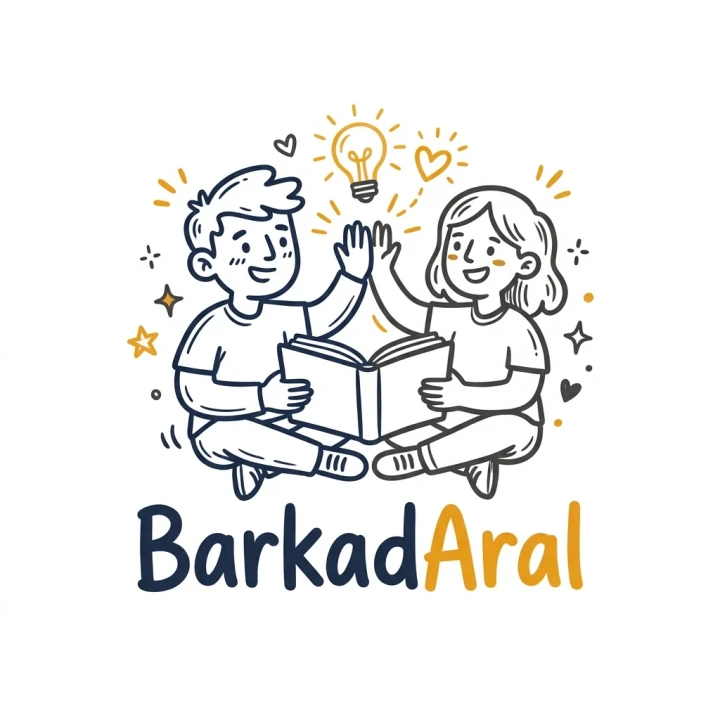

<p align="center"></p>

# BarkadAral

**Barkada + aral**: your AI study barkada. An AI study tool: paste your lecture notes (or upload a PDF) and get a **summary**, **flashcards** and a **practice quiz** in seconds.

**Live demo:** _add your Vercel link here_

 <!-- add a screenshot after deploying -->

## Features

- **Summary and key terms**: the main ideas of your notes on one review sheet.
- **Flashcards**: flip with a click or the Space bar, shuffle, and mark cards as known.
- **Practice quiz**: multiple choice with a score and an explanation for every answer.
- **PDF upload**: Gemini reads the PDF directly, including slides and diagrams.
- **Difficulty levels**: easy (recall), medium (understanding), hard (application).
- **Any language**: notes in Filipino get questions in Filipino.
- **History**: your study sets are saved in the browser.
- **Dark mode** and mobile-friendly layout.

## Tech stack

- [Next.js](https://nextjs.org) (App Router) + TypeScript
- Tailwind CSS
- [Google Gemini API](https://ai.google.dev) (free tier) via the official `@google/genai` SDK
- [Zod](https://zod.dev) for **structured outputs**: the schema is converted to JSON Schema and sent to Gemini, so the AI must answer in that exact shape, and the server validates it again before using it.

## How it works

1. The browser sends your notes (or the PDF as base64) to `POST /api/generate`.
2. The API route validates the input with Zod and applies a per-visitor rate limit.
3. It calls Gemini with a tutor system prompt and a JSON schema (`src/lib/schemas.ts`).
4. Gemini's response is parsed and validated with Zod, then returned to the page.
5. The page shows it in three tabs and saves it to `localStorage`.

The API key stays on the server; it is never sent to the browser.

```
src/
  app/
    page.tsx               # main page (input, history, results tabs)
    api/generate/route.ts  # calls Gemini
  components/              # Summary, Flashcards, Quiz
  lib/
    schemas.ts             # Zod schemas shared by server and client
    rate-limit.ts          # simple per-IP limiter
    sample-notes.ts        # demo notes
```

## Run it locally

```bash
npm install
cp .env.example .env.local   # then paste your free Gemini key into .env.local
npm run dev
```

Open http://localhost:3000 and click **Try sample notes**.

## Deploy to Vercel

1. Push this project to a GitHub repository.
2. Go to [vercel.com/new](https://vercel.com/new) and import the repository.
3. Under **Environment Variables**, add `GEMINI_API_KEY`.
4. Click **Deploy**.

**About the free tier:** it has request limits, and Google may use free-tier prompts to improve its products, so don't upload private documents. The built-in rate limit is per server instance, so it's a soft limit only.

## Ideas for next versions

- User accounts and cloud sync (Supabase)
- Spaced repetition scheduling for flashcards
- "Explain this to me" chat about a quiz question
- Export flashcards to Anki / CSV

## Author

Made by **Jhan Maurice De Roxas**.
